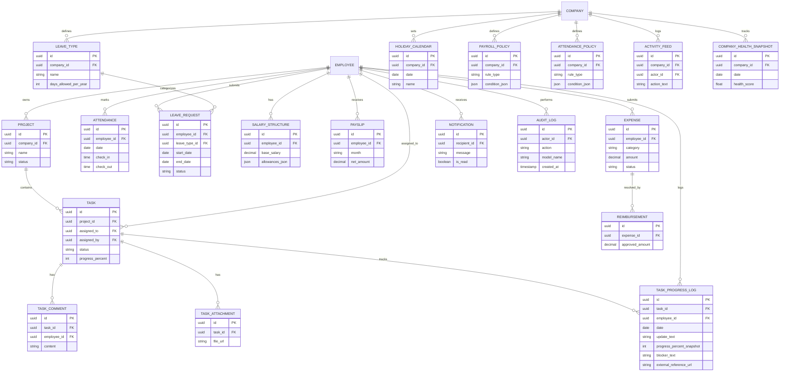

# Ordinis — Full Commercial Product ER Diagram (All Layers)

> **Future vision, not the delivered system.** Most entities below are not built. The ER diagram of what is delivered is `ordinis-ER-diagram.md` (generated from the code).

এটা **সম্পূর্ণ commercial product scope** (Layer 1: Core Engine + Layer 2: Business Modules + Layer 3: Extension Ecosystem) — কোর্স প্রজেক্ট scope না। GitHub-এ push করলে mermaid automatically render হবে।

> **Note:** এত বড় schema (৪৫+ entity) এক diagram-এ field-level detail সহ visually পড়া কঠিন — তাই নিচে **Layer অনুযায়ী আলাদা mermaid diagram** দেওয়া হলো। পুরো system-এর visual cluster-overview এর জন্য `ordinis-full-er-diagram.png` দেখো।

---

## Layer 1 — Core Engine (Platform + Tenant + Identity + RBAC + Workflow)

```mermaid
erDiagram
  PLATFORM_ADMIN ||--o{ SUPPORT_TICKET : handles
  PLATFORM_ADMIN ||--o{ SUPPORT_ACCESS_REQUEST : requests
  COMPANY ||--o{ SUPPORT_ACCESS_REQUEST : approves
  PLATFORM_ADMIN ||--o{ IMPERSONATION_LOG : performs
  EMPLOYEE ||--o{ IMPERSONATION_LOG : target_of
  COMPANY ||--o{ SUPPORT_TICKET : raises
  COMPANY ||--o{ SUBSCRIPTION : has
  SUBSCRIPTION_PLAN ||--o{ SUBSCRIPTION : defines
  SUBSCRIPTION ||--o{ INVOICE : generates
  INVOICE ||--o{ PAYMENT : paid_by

  COMPANY ||--o{ USER : has
  USER ||--|| EMPLOYEE : is
  USER ||--o{ PASSWORD_RESET_TOKEN : requests
  USER ||--o| TWO_FACTOR_AUTH : secures
  USER ||--o{ ACTIVE_SESSION : maintains
  COMPANY ||--o{ COMPANY_IP_WHITELIST : restricts
  USER ||--o{ SECURITY_EVENT : triggers
  COMPANY ||--o{ FILE_UPLOAD_POLICY : configures
  COMPANY ||--o{ EMPLOYEE : has
  COMPANY ||--o{ DEPARTMENT : has
  COMPANY ||--o{ DESIGNATION : has
  DEPARTMENT ||--o{ EMPLOYEE : contains
  DESIGNATION ||--o{ EMPLOYEE : labels
  EMPLOYEE ||--o{ EMPLOYEE : reports_to

  COMPANY ||--o{ ROLE : defines
  PERMISSION ||--o{ ROLE_PERMISSION : included_in
  ROLE ||--o{ ROLE_PERMISSION : grants
  EMPLOYEE ||--o{ EMPLOYEE_ROLE : assigned
  ROLE ||--o{ EMPLOYEE_ROLE : assigned_to

  COMPANY ||--o{ APPROVAL_CHAIN : configures
  APPROVAL_CHAIN ||--o{ APPROVAL_STEP : has
  APPROVAL_CHAIN ||--o{ APPROVAL_INSTANCE : creates
  APPROVAL_INSTANCE ||--o{ APPROVAL_ACTION : logs
  EMPLOYEE ||--o{ DELEGATION_RULE : delegates
  COMPANY ||--o{ POLICY_RULE : sets
  COMPANY ||--|| COMPANY_SETTINGS : configures
  COMPANY ||--o{ ROLE_TEMPLATE : offers
  EMPLOYEE ||--o{ NOTIFICATION_PREFERENCE : sets

  COMPANY_SETTINGS {
    uuid id PK
    uuid company_id FK
    string currency
    string fiscal_year_start
    string default_language
  }
  ROLE_TEMPLATE {
    uuid id PK
    string name
    json default_permissions_json
  }
  NOTIFICATION_PREFERENCE {
    uuid id PK
    uuid employee_id FK
    string channel
    boolean enabled
  }

  PLATFORM_ADMIN {
    uuid id PK
    string email
    string permission_level
  }
  SUPPORT_TICKET {
    uuid id PK
    uuid company_id FK
    string subject
    string status
  }
  SUPPORT_ACCESS_REQUEST {
    uuid id PK
    uuid platform_admin_id FK
    uuid company_id FK
    string reason
    string status
    uuid approved_by FK
    timestamp expires_at
  }
  IMPERSONATION_LOG {
    uuid id PK
    uuid platform_admin_id FK
    uuid target_employee_id FK
    uuid access_request_id FK
    string reason
    timestamp started_at
    timestamp ended_at
  }
  COMPANY {
    uuid id PK
    string name
    string subdomain
    boolean is_active
  }
  SUBSCRIPTION_PLAN {
    uuid id PK
    string name
    int max_employees
    decimal price_monthly
  }
  SUBSCRIPTION {
    uuid id PK
    uuid company_id FK
    uuid plan_id FK
    string status
  }
  INVOICE {
    uuid id PK
    uuid subscription_id FK
    decimal amount
    string status
  }
  PAYMENT {
    uuid id PK
    uuid invoice_id FK
    string gateway
    string transaction_id
  }
  USER {
    uuid id PK
    uuid company_id FK
    string email
    string password_hash
  }
  PASSWORD_RESET_TOKEN {
    uuid id PK
    uuid user_id FK
    string token_hash
    timestamp expires_at
    boolean used
  }
  ACTIVE_SESSION {
    uuid id PK
    uuid user_id FK
    string session_token_hash
    string ip_address
    string device_info
    timestamp last_active_at
  }
  TWO_FACTOR_AUTH {
    uuid id PK
    uuid user_id FK
    string secret_key_encrypted
    boolean is_enabled
  }
  COMPANY_IP_WHITELIST {
    uuid id PK
    uuid company_id FK
    string ip_range
    boolean is_active
  }
  SECURITY_EVENT {
    uuid id PK
    uuid user_id FK
    string event_type
    string ip_address
    timestamp created_at
  }
  FILE_UPLOAD_POLICY {
    uuid id PK
    uuid company_id FK
    string context
    json allowed_extensions
    int max_file_size_mb
  }
  EMPLOYEE {
    uuid id PK
    uuid user_id FK
    uuid company_id FK
    uuid department_id FK
    uuid designation_id FK
    uuid reports_to FK
    string employee_code
  }
  DEPARTMENT {
    uuid id PK
    uuid company_id FK
    string name
  }
  DESIGNATION {
    uuid id PK
    uuid company_id FK
    string title
  }
  PERMISSION {
    uuid id PK
    string codename
    string module
  }
  ROLE {
    uuid id PK
    uuid company_id FK
    string name
  }
  ROLE_PERMISSION {
    uuid role_id FK
    uuid permission_id FK
  }
  EMPLOYEE_ROLE {
    uuid employee_id FK
    uuid role_id FK
  }
  APPROVAL_CHAIN {
    uuid id PK
    uuid company_id FK
    string applies_to_module
  }
  APPROVAL_STEP {
    uuid id PK
    uuid approval_chain_id FK
    int step_order
    uuid approver_role_id FK
  }
  APPROVAL_INSTANCE {
    uuid id PK
    uuid approval_chain_id FK
    string related_object_type
    uuid related_object_id
    string status
  }
  APPROVAL_ACTION {
    uuid id PK
    uuid approval_instance_id FK
    uuid actor_id FK
    string decision
  }
  DELEGATION_RULE {
    uuid id PK
    uuid employee_id FK
    uuid delegate_to FK
    date start_date
    date end_date
  }
  POLICY_RULE {
    uuid id PK
    uuid company_id FK
    string rule_type
    json condition_json
  }
```

---

## Layer 2 — Business Modules (Task, Attendance, Payroll, Notification, Audit, Analytics)

---

## Layer 3 — Extension Ecosystem (Future Roadmap Modules)

```mermaid
erDiagram
  COMPANY ||--o{ MEETING : schedules
  EMPLOYEE ||--o{ MEETING : organizes
  MEETING ||--o{ MEETING_PARTICIPANT : invites
  EMPLOYEE ||--o{ MEETING_PARTICIPANT : attends
  MEETING ||--o{ MEETING_ACTION_ITEM : produces
  MEETING_ACTION_ITEM ||--o| TASK : converts_to

  COMPANY ||--o{ ANNOUNCEMENT : publishes
  EMPLOYEE ||--o{ ANNOUNCEMENT : creates
  ANNOUNCEMENT ||--o{ ANNOUNCEMENT_READ : tracked_by
  EMPLOYEE ||--o{ ANNOUNCEMENT_READ : reads

  COMPANY ||--o{ DIRECT_MESSAGE_THREAD : contains
  EMPLOYEE ||--o{ DIRECT_MESSAGE_THREAD : participates
  DIRECT_MESSAGE_THREAD ||--o{ DIRECT_MESSAGE : holds
  EMPLOYEE ||--o{ DIRECT_MESSAGE : sends

  COMPANY ||--o{ TICKET : receives
  EMPLOYEE ||--o{ TICKET : raises

  COMPANY ||--o{ ASSET : owns
  EMPLOYEE ||--o{ ASSET : assigned

  COMPANY ||--o{ DOCUMENT : stores
  EMPLOYEE ||--o{ DOCUMENT : owns

  COMPANY ||--o{ KNOWLEDGE_ARTICLE : publishes
  EMPLOYEE ||--o{ PERFORMANCE_REVIEW : reviewed_in
  COMPANY ||--o{ SURVEY : creates
  SURVEY ||--o{ SURVEY_RESPONSE : collects
  EMPLOYEE ||--o{ SURVEY_RESPONSE : submits

  COMPANY ||--o{ VISITOR : logs
  EMPLOYEE ||--o{ VISITOR : hosts

  COMPANY ||--o{ CUSTOM_FIELD : defines
  COMPANY ||--o{ FORM_TEMPLATE : defines

  MEETING {
    uuid id PK
    uuid company_id FK
    string title
    string agenda
    timestamp scheduled_at
  }
  MEETING_ACTION_ITEM {
    uuid id PK
    uuid meeting_id FK
    string description
    uuid assigned_to FK
    uuid task_id FK
  }
  MEETING_PARTICIPANT {
    uuid id PK
    uuid meeting_id FK
    uuid employee_id FK
    string rsvp_status
  }
  ANNOUNCEMENT {
    uuid id PK
    uuid company_id FK
    uuid created_by FK
    string title
    string scope_type
    uuid scope_target
  }
  ANNOUNCEMENT_READ {
    uuid id PK
    uuid announcement_id FK
    uuid employee_id FK
    timestamp read_at
  }
  DIRECT_MESSAGE_THREAD {
    uuid id PK
    uuid company_id FK
    uuid participant_one FK
    uuid participant_two FK
  }
  DIRECT_MESSAGE {
    uuid id PK
    uuid thread_id FK
    uuid sender_id FK
    string content
    boolean is_read
    timestamp sent_at
  }
  TICKET {
    uuid id PK
    uuid company_id FK
    uuid raised_by FK
    string category
    string status
  }
  ASSET {
    uuid id PK
    uuid company_id FK
    string name
    string serial_number
    uuid assigned_to FK
  }
  DOCUMENT {
    uuid id PK
    uuid employee_id FK
    string document_type
    string file_url
  }
  KNOWLEDGE_ARTICLE {
    uuid id PK
    uuid company_id FK
    string title
    string category
  }
  PERFORMANCE_REVIEW {
    uuid id PK
    uuid employee_id FK
    uuid reviewer_id FK
    string period
    float score
  }
  SURVEY {
    uuid id PK
    uuid company_id FK
    string title
    json questions_json
  }
  SURVEY_RESPONSE {
    uuid id PK
    uuid survey_id FK
    uuid employee_id FK
    json answers_json
  }
  VISITOR {
    uuid id PK
    uuid company_id FK
    string name
    uuid host_employee_id FK
    timestamp check_in
  }
  CUSTOM_FIELD {
    uuid id PK
    uuid company_id FK
    string model_name
    string field_name
  }
  FORM_TEMPLATE {
    uuid id PK
    uuid company_id FK
    string form_type
    json schema_json
  }
```

---

## Full Entity Count Summary

| Layer | Entity Count | Status |
|---|---|---|
| Layer 1 — Core Engine | 32 entities | ✅ Build first (Foundation of everything) |
| Layer 2 — Business Modules | 23 entities | ✅ Build second |
| Layer 3 — Extension Ecosystem | 18 entities | ⏳ Future roadmap |
| **Total** | **~73 entities** | Full commercial product scope |

**দ্রষ্টব্য:** Layer 1-এর `EMPLOYEE` entity-ই পুরো schema-র কেন্দ্র — প্রায় প্রতিটা Layer 2/3 entity সরাসরি বা পরোক্ষভাবে `EMPLOYEE`-এর সাথে যুক্ত। এই কারণেই `organization` app (যেটা Employee hierarchy handle করে) সবচেয়ে বেশি গুরুত্ব দিয়ে design করা দরকার — এখানে ভুল হলে পুরো system-এর উপর প্রভাব পড়বে।

---

## Gap-Fix Log (এই ভার্সনে যা যোগ হলো)

আগের version-এ যেসব logical gap ছিল, সেগুলো এই আপডেটে ঠিক করা হয়েছে:

| Gap | কেন সমস্যা ছিল | Fix |
|---|---|---|
| Currency কোথাও define ছিল না | Payroll/Billing টাকার হিসাব করে, কিন্তু কোন currency সেটা অনির্ধারিত | `COMPANY_SETTINGS` entity-তে `currency` field যোগ |
| Payroll deduction rule hardcoded হওয়ার ঝুঁকি | Leave-based deduction, tax rule company-ভেদে ভিন্ন হতে পারে | `PAYROLL_POLICY` entity যোগ (data-driven, `POLICY_RULE`-এর মতোই প্যাটার্ন) |
| Attendance rule (late penalty ইত্যাদি) কোথাও ছিল না | Company-ভেদে "late" এর সংজ্ঞা ভিন্ন হতে পারে | `ATTENDANCE_POLICY` entity যোগ |
| Meeting-এ কে invited, RSVP status কোথায় থাকবে অনির্ধারিত ছিল | আগে conceptually বলা হলেও schema-তে entity ছিল না | `MEETING_PARTICIPANT` entity যোগ |
| Announcement-এর কোনো entity-ই ছিল না | পুরো flow আগে আলোচনা হলেও ER diagram-এ কখনো যোগ হয়নি | `ANNOUNCEMENT` + `ANNOUNCEMENT_READ` entity যোগ |
| নতুন company-কে শুরু থেকে Role/Permission বানাতে হতো | খারাপ onboarding experience, ভুল হওয়ার সম্ভাবনা বেশি | `ROLE_TEMPLATE` entity যোগ (Startup/Enterprise preset) |
| Notification সবাই একইভাবে পাবে ধরে নেওয়া হয়েছিল | কেউ email off রাখতে চাইতে পারে | `NOTIFICATION_PREFERENCE` entity যোগ |
| Company settings (timezone, currency, fiscal year) Company টেবিলেই গাদাগাদি হচ্ছিল | Company entity বড় ও এলোমেলো হয়ে যাচ্ছিল | আলাদা `COMPANY_SETTINGS` entity, one-to-one relation |
| Password change/reset flow-এর কোনো entity ছিল না | User-এর password_hash ছিল, কিন্তু "ভুলে গেলে কী হবে" পুরো flow অনুপস্থিত ছিল | `PASSWORD_RESET_TOKEN` entity যোগ (hashed token, expiry, single-use) |
| Super Admin-এর client data access unrestricted/undefined ছিল | Debugging/misuse-monitoring-এর genuine প্রয়োজন আছে, কিন্তু unrestricted access client trust ও legal ঝুঁকি তৈরি করে | `SUPPORT_ACCESS_REQUEST` (company approval + time-limited) ও `IMPERSONATION_LOG` (audit trail সহ "Break Glass" pattern) যোগ |
| Multi-Factor Authentication (MFA) কোথাও ছিল না | শুধু password-নির্ভর login, password leak হলে পুরো account compromise | `TWO_FACTOR_AUTH` entity (TOTP-based) যোগ |
| Active session track/revoke করার কোনো উপায় ছিল না | Hijacked session বন্ধ করার সুযোগ নেই | `ACTIVE_SESSION` entity যোগ |
| Enterprise-level IP restriction option ছিল না | বড় client চাইতে পারে "শুধু অফিসের IP থেকে login" | `COMPANY_IP_WHITELIST` entity যোগ |
| Security-specific event সাধারণ AuditLog-এর সাথে মিশে ছিল | Failed login/permission-denied আলাদাভাবে monitor করা কঠিন হতো | `SECURITY_EVENT` entity আলাদা করে যোগ |
| Multi-day Task-এর দৈনিক progress track করার কোনো উপায় ছিল না (code upload কোনো সমাধান না) | Developer-এর মতো role-এ ৭ দিনের task-এ daily visibility দরকার, কিন্তু raw code Ordinis-এ রাখা উচিত না | `TASK_PROGRESS_LOG` entity যোগ (daily text update + progress % + optional external reference link, যেমন GitHub commit URL) |
| Employee-দের মধ্যে সরাসরি (hierarchy-নির্বিশেষে) communication করার কোনো উপায় ছিল না | TaskComment শুধু task-context-এ কথা বলায়, company directory থেকে যে কাউকে personally message করার দরকার ছিল | `DIRECT_MESSAGE_THREAD` ও `DIRECT_MESSAGE` entity যোগ (group chat না, শুধু 1-to-1, hierarchy-restriction ছাড়া open access) |
